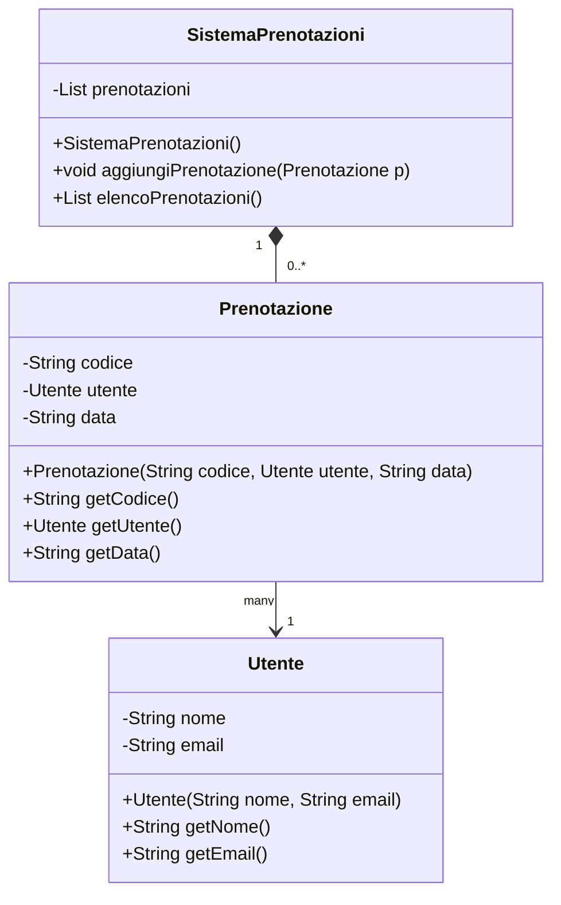
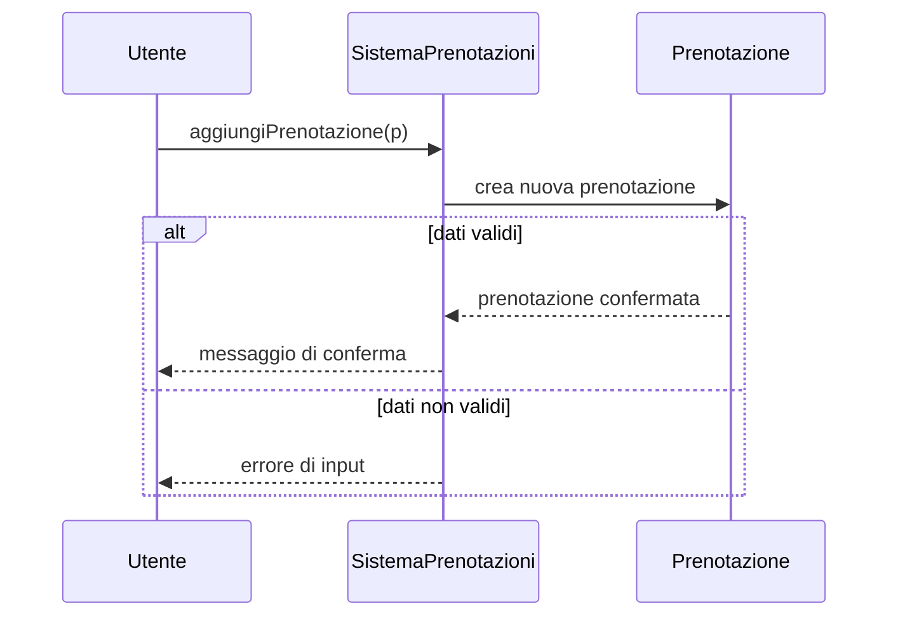

# Architettura del progetto

Il progetto scelto rappresenta una semplice applicazione di gestione prenotazioni. La parte principale è composta da tre classi: `Utente`, `Prenotazione` e `SistemaPrenotazioni`.

Il diagramma delle classi mostra che `SistemaPrenotazioni` contiene una collezione di prenotazioni, mentre ogni prenotazione è associata a un solo utente. La relazione di composizione indica che la lista di prenotazioni appartiene al sistema, mentre l'associazione mostra il legame tra prenotazione e utente.

La sequenza descrive il flusso di registrazione di una prenotazione: il cliente interagisce con il sistema, il sistema crea la prenotazione e decide, in base ai dati ricevuti, se confermarla o segnalare un errore.
