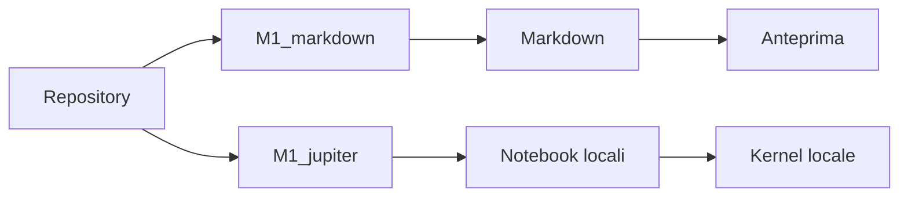

# Repository di Informatica — Giulio Peroni — 4Bi

## Obiettivo

Questo repository raccoglie i materiali, le verifiche e le consegne del corso di Informatica della classe 4Bi. La struttura è organizzata per modulo e contiene documentazione, esercizi in Markdown e notebook locali eseguiti senza usare il server remoto.

## Struttura

```text
.
├── M0_ambiente_lavoro_ripasso_git/
├── M1_markdown/
├── M1_jupiter/
├── M2_fondamenti_linguaggio_python/
├── M3_strutture_dati_native_python/
├── M4_funzioni_moduli_organizzazione_codice/
├── M5_gestione_file_eccezioni/
├── M6_programmazione_orientata_oggetti_python/
└── M8_programmazione_concorrente_rete/
```

## Convenzioni

- Le cartelle dei moduli seguono il formato `M<numero>_<titolo_in_minuscolo>`.
- I file Markdown sono salvati nella cartella del modulo corrispondente.
- I notebook vengono creati come file `.ipynb` locali dentro `M1_jupiter/` e verificati con il kernel del workspace.
- Non vengono usati server istituzionali per le consegne di notebook.

## Istruzioni

1. Aprire la cartella del repository in VS Code.
2. Aprire la cartella del modulo da svolgere.
3. Controllare i file Markdown in anteprima con `Ctrl+K` seguito da `V`.
4. Per i notebook, usare `Restart Kernel and Run All Cells` e verificare che l'esecuzione termini senza errori.
5. Conservare i file in ordine e mantenere i percorsi relativi corretti.

## Modulo M1

Il modulo M1 raccoglie la documentazione tecnica, i collegamenti utili, le relazioni e i notebook locali. In questa sezione sono presenti le consegne di base, intermedie e avanzate sviluppate con file Markdown e `.ipynb` nel repository.



## Autore

Giulio Peroni — 4Bi  
Contatto istituzionale: disponibile tramite account scolastico e repository del corso.  
Licenza: uso didattico e scolastico per il laboratorio di Informatica.
